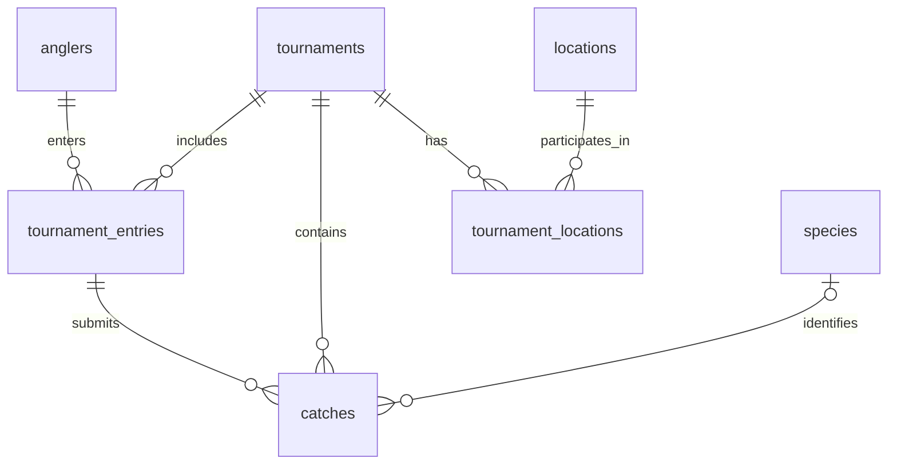

# Database schema

This schema supports TourneyX standings ingestion. See [INGESTION.md](INGESTION.md)
for batch imports, raw snapshot replay, and the existing-data backfill.

## Tables

### tournaments

| Column           | Suggested type | Constraints / purpose                                                                            |
| ---------------- | -------------- | ------------------------------------------------------------------------------------------------ |
| `id`             | bigint         | Primary key, generated internally.                                                               |
| `name`           | text           | Required tournament name.                                                                        |
| `date`           | date           | Required calendar date. |
| `timezone`       | text           | Required IANA timezone, such as `America/New_York`, for interpreting and displaying catch times. |
| `starts_at` / `ends_at` | timestamp with time zone | Nullable pair of source tournament start/end times, normalized to UTC; end must follow start. |
| `weather_latitude` / `weather_longitude` | double precision | Nullable coordinate pair parsed from source metadata `lat_lng`; latitude within -90 to 90, longitude within -180 to 180. |
| `source_url`     | text           | Required canonical source standings URL; unique for the initial TourneyX import.                 |
| `external_id`    | text           | Optional TourneyX tournament identifier; unique when present.                                    |
| `catch_coverage` | text           | Required; initially `standings_only`.                                                            |
| `winning_length_inches` | numeric(12,2) | First-place angler's standings score in inches; nonnegative, nullable if unavailable. |
| `top_10_percent_length_inches` | numeric(12,2) | Standings score at the finishing place nearest 10% of the field; nonnegative, nullable if unavailable. |

The calendar date can be displayed as day/month/year. `DATE` stores the date
without a time or display format. The model keeps one date per tournament.
Duration fields describe that day's tournament hours. Weather coordinates
represent the source's event point, whose relationship to the fishing area
is not independently verified; they do not locate catches or eligible waters.

Length fields use the complete captured standings, including zero-fish anglers
in the field size. `winning_length_inches` is the highest score.
`top_10_percent_length_inches` is the score at the finishing place nearest
`angler_count / 10`, rounding .5 upward with a minimum place of 1. For example,
100 anglers use 10th place, 48 use 5th, and 73 use 7th. Select scores sorted
from highest to lowest; tied scores have the same value at the cutoff.
An empty field leaves both fields null. Invalid or missing scores for anglers
with fish leave both fields null and block import review; a missing score for
an angler without fish counts as zero. These scores cover standings fish,
excluding culled fish absent from the standings. They are calculated from the
full snapshot even for a partial catch export and should be recalculated
whenever the standings are refreshed.

### locations

| Column  | Suggested type | Constraints / purpose                                                    |
| ------- | -------------- | ------------------------------------------------------------------------ |
| `id`    | bigint         | Primary key, generated internally.                                       |
| `name`  | text           | Required canonical waterbody name.                                       |
| `state` | text           | State abbreviation, such as `PA`; nullable if unknown or not applicable. |

Locations represent waterbodies, rather than the event's listed city or awards
venue. Assign canonical locations manually during initial import. Do not assume a waterbody name alone is globally
unique.

### tournament_locations

| Column           | Suggested type | Constraints / purpose                                             |
| ---------------- | -------------- | ----------------------------------------------------------------- |
| `tournament_id`  | bigint         | Required foreign key to `tournaments.id`.                         |
| `location_id`    | bigint         | Required foreign key to `locations.id`.                           |
| `boundary_notes` | text           | Optional description of the section eligible for this tournament. |

Use `(tournament_id, location_id)` as the composite primary key. This permits
multiple waterbodies per tournament and multiple tournaments per waterbody.
Boundary notes belong here because eligible sections can differ between events.
A tournament can temporarily have no location assignments while awaiting review.

### species

| Column | Suggested type | Constraints / purpose                    |
| ------ | -------------- | ---------------------------------------- |
| `id`   | bigint         | Primary key, generated internally.       |
| `name` | text           | Required, unique canonical species name. |

Normalize source labels of `Bass` to `Largemouth Bass` during import.

### anglers

- `id`: generated bigint primary key.
- `external_id`: required unique TourneyX user ID; names never determine identity.
- `name`: latest captured display name.
- `name_observed_at`: required UTC capture timestamp; older snapshots cannot replace a newer name.

### tournament_entries

- `(tournament_id, angler_id)`: composite primary key, referencing tournaments and anglers.
- `angler_name`: required name captured for this event.
- Includes zero-fish standings participants. Indexed by `angler_id`.

### catches

| Column          | Suggested type           | Constraints / purpose                                                 |
| --------------- | ------------------------ | --------------------------------------------------------------------- |
| `id`            | bigint                   | Primary key, generated internally.                                    |
| `tournament_id` | bigint                   | Required foreign key to `tournaments.id`.                             |
| `angler_id` | bigint | Required angler identity; `(tournament_id, angler_id)` references `tournament_entries`. |
| `angler_name` | text | Historical display name captured for this catch. |
| `catch_time`    | timestamp with time zone | Required full catch date and time, normalized to UTC on import.       |
| `species_id`    | bigint                   | Nullable foreign key to `species.id`; older records may lack species. |
| `length_inches` | numeric(6,2)             | Required positive decimal length in inches.                           |
| `external_id`   | text                     | Optional stable source catch identifier, if available.                |

When `external_id` is present, enforce uniqueness on
`(tournament_id, external_id)`. Do not treat angler name, timestamp, and length
as a guaranteed unique catch identifier. When a stable source identifier is
unavailable, review or replace a tournament's imported catch set rather than
blindly appending it on every import.

## Relationships

For a multi-waterbody event, create one tournament and link each eligible
waterbody through `tournament_locations`. Do not duplicate its catches for each
waterbody.

## Import conventions and known limitations

- Only fish visible in the standings are available. These are not all submitted
  fish; record `catch_coverage = 'standings_only'`.
- `catch_time` currently comes from the source's **Picture Taken** timestamp,
  used as a proxy for catch time rather than submission time.
- Interpret source timestamps in the tournament's configured timezone before
  converting them to UTC. For these Eastern US events, use
  `America/New_York`, which accounts for daylight saving time.
- Preserve unknown species as `NULL`; retain the agreed Bass-to-Largemouth Bass
  normalization when a source species label is present.
- Internal IDs belong to this database. External IDs refer to source records
  and are nullable when the source does not expose a stable identifier.
- The initial source is TourneyX. Supporting additional providers later requires
  source-qualified external identifiers and corresponding uniqueness rules.
- Keep raw snapshots and import issue reports outside these core tables so
  parsing errors and missing data can be reviewed before database insertion.

## Initial indexes

Primary keys and unique constraints provide their corresponding indexes.
Additionally, add:

- `catches (tournament_id, catch_time)` for tournament catch timelines.
- `catches (species_id)` for species filtering.
- `catches (angler_id)` for angler filtering.
- `tournament_entries (angler_id)` for finding an angler's tournaments.
- `tournament_locations (location_id, tournament_id)` for finding tournaments
  associated with a waterbody.

Add further indexes when actual application queries justify them.
